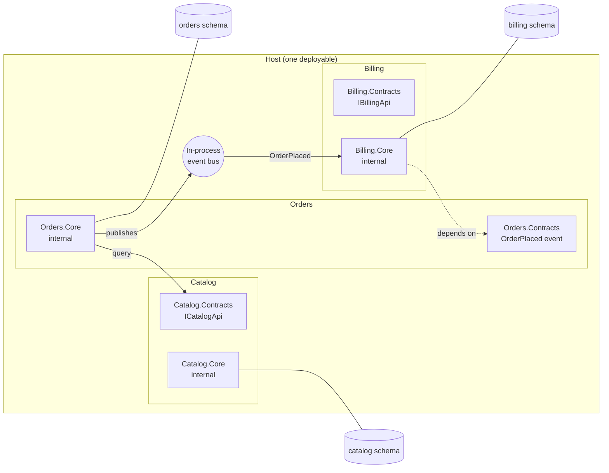

# modular-monolith-dotnet

**Six developers. Twelve microservices. One shared database. Would you approve this architecture?**

This is a .NET 10 reference for the alternative: a **modular monolith**. It ships as one deployable,
with hard module boundaries that **CI enforces**, so you can extract a service later when a measured
reason appears.

[](../../actions/workflows/ci.yml)


## Architecture



## Rules, enforced by tests

| Rule | Why | Test |
|---|---|---|
| A module never references another module's `Core` | Stops hidden coupling | `A_module_never_references_another_modules_Core` |
| `Contracts` depend only on `BuildingBlocks` | Keeps contracts stable and extractable | `Contracts_depend_only_on_BuildingBlocks` |
| Only the `IModule` entry point is public in `Core` | Internals can't leak | `Module_internals_are_not_public` |
| `BuildingBlocks` knows no business module | Infrastructure stays generic | `BuildingBlocks_knows_nothing_about_business_modules` |
| Event consumers are idempotent | Brokers redeliver | `Placing_an_order_issues_exactly_one_invoice…` |

## Try it

```bash
dotnet test
dotnet run --project src/Host --urls http://localhost:5078

curl -H "Content-Type: application/json" \
  -d '{"customerId":"cus_7","lines":[{"sku":"ARCH-REVIEW","quantity":1},{"sku":"SUPPORT-HR","quantity":10}]}' \
  localhost:5078/orders
curl localhost:5078/billing/orders/<order-id>/invoice   # invoice issued by Billing via the OrderPlaced event
```

## When to extract a service

See [ADR-0001](docs/adr-0001-modular-monolith-first.md). In short, extract when there is a *measured*
need for independent scaling, an independent release cadence, isolation (PCI, PHI, blast radius), or a
team ready to own the service end to end. Because modules share no tables and talk only through
contracts and events, extraction means swapping adapters, not rewriting the business logic.

## Structure

```
src/BuildingBlocks          IModule, integration events, in-process bus
src/Modules/<Name>/<Name>.Contracts   public API + events
src/Modules/<Name>/<Name>.Core        internal implementation + endpoints
src/Host                    composition root (explicit module list)
tests/                      architecture rules + cross-module behaviour
```

---
Author: [Rubbaite T. Hassain](https://tanvir.info.bd) ([LinkedIn](https://www.linkedin.com/in/rubbaite)) · Software Architect, Founder of [Datazo InfoTech](https://www.datazoinfotech.com.bd) · MIT License

Architecture, requirements and review by Rubbaite T. Hassain; implementation AI-assisted.
